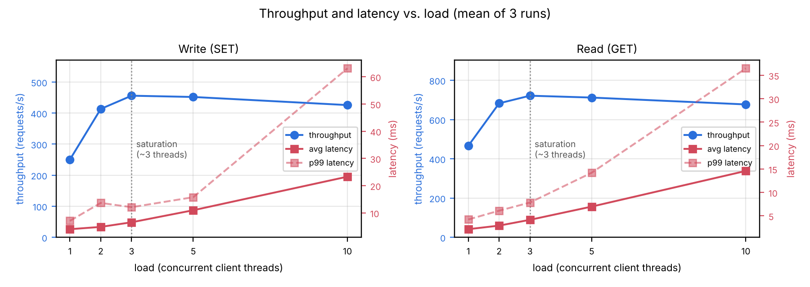

# CSCI 5144 Cloud Computing — Assignment 1: Single-Server Key-Value Store

Team members: Shuyuan Yang, Sitong Pan, Baanee Singh, Shaan Sidhu  
Source code: <https://github.com/baaneedeol/CSCI5144-CloudComputing>

### Design Decisions

We used Python and Flask because they provide a lightweight way to build an HTTP server with minimal dependencies. The server runs on port 8080 and supports GET, PUT, POST, and DELETE. Values are stored in a Python dictionary protected by a thread lock, and Flask's threaded mode handles multiple client requests concurrently. For persistence, the server writes the dictionary to a JSON file after every successful PUT, POST, and DELETE; it writes to a temporary file and then replaces the data file, reducing the risk of partial writes. Timestamped logging records successful operations, missing keys, errors, and server activity.

### Challenges and Testing

A key challenge was keeping data consistent when multiple requests modify the same key; we protect both dictionary access and file updates with the lock. To keep memory consistent with disk when a write fails, the server retains the previous value and restores it. The server validates that PUT/POST requests carry JSON with a `value` field, rejects values that cannot be serialized as valid JSON, and returns appropriate status codes for invalid requests, missing keys, and persistence errors. Functional tests covered all operations, updates, invalid requests, missing keys, concurrent requests, and persistence across restarts.

With the course benchmark (3 client threads, 300 keys written then read back and verified), a single run on a Linux machine completed 600 operations with zero errors and zero mismatches: writes 615.4 ops/s (avg 4.86 ms, p99 15.46 ms), reads 1,551.4 ops/s (avg 1.93 ms, p99 3.49 ms), overall 881.2 ops/s in 0.68 s. Results may vary across runs and hardware.

Scaling with thread count. We repeated the benchmark with 1, 2, 3, 5, and 10 threads, three runs each, with zero errors and mismatches, on a different machine (Ubuntu 24.04 VM, 4 vCPUs Intel Xeon @ 2.10 GHz, 15 GB RAM, Python 3.13, Flask 3.1). Throughput levels off at about three threads (writes ≈ 456 ops/s, reads ≈ 721 ops/s); more threads only raise latency. Writes are slower than reads because each write rewrites and fsyncs the data file under the global lock.

*Figure 1. Throughput (left axis) and average/p99 latency (right axis) vs. number of client threads; mean of three runs.*

### Assumptions and Future Improvements

We assume a single server process at `127.0.0.1:8080`, JSON-compatible values, and a writable data file. A missing data file starts an empty store, while an unreadable or invalid file prevents startup so saved data is never silently discarded. The system targets a small-scale assignment, not production. Future work: reduce lock contention from disk persistence, use a dedicated storage engine for larger datasets, add configurable and mixed read/write workloads, automated concurrency tests, stronger crash recovery, request-size limits, and authentication if exposed beyond the local machine.
