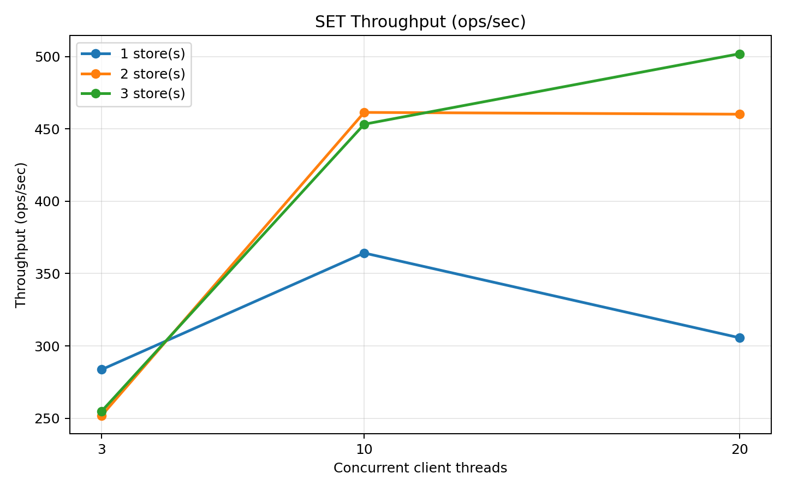
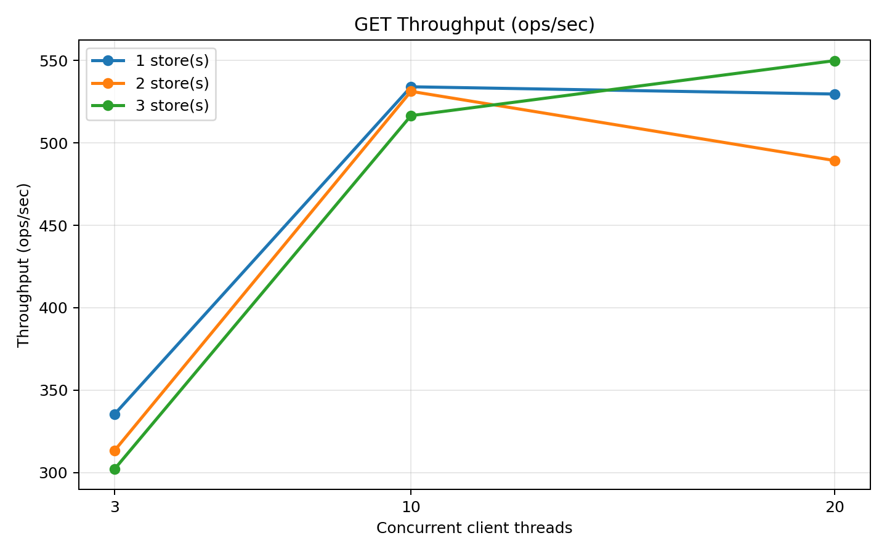
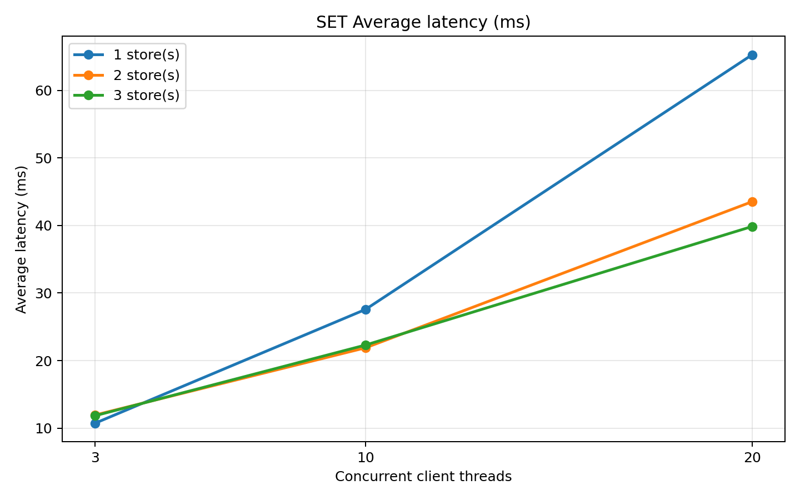
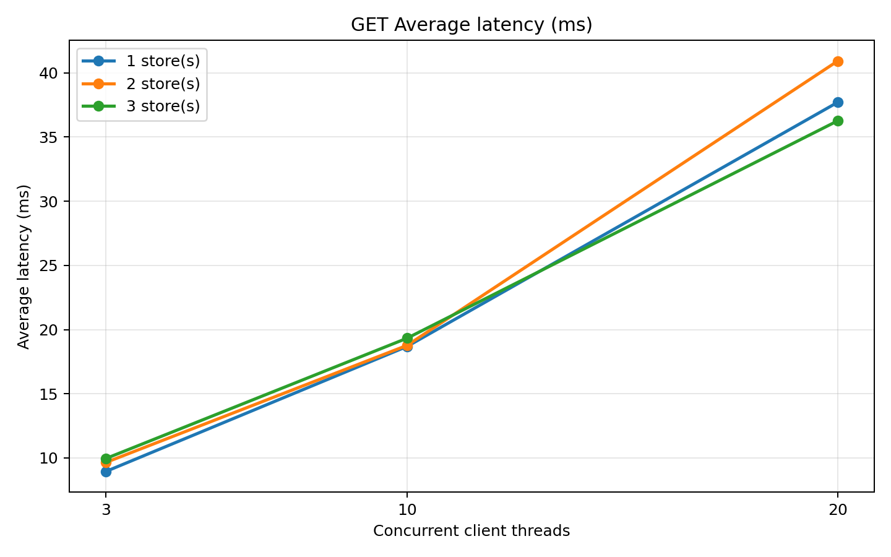
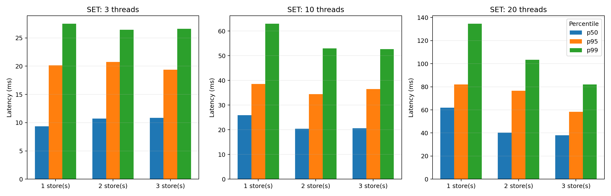
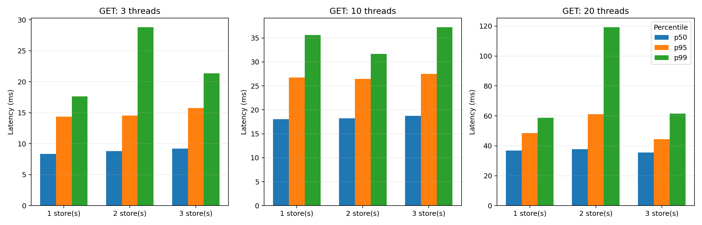

# CSCI 5144 Cloud Computing — Assignment 3: Docker-Based Distributed Key-Value Store

**Team Members:** Shuyuan Yang, Sitong Pan, Baanee Singh, Shaan Sidhu  
**Source Code:** [GitHub Repository](https://github.com/baaneedeol/CSCI5144-CloudComputing)

## 1. Introduction

A distributed key-value (KV) store partitions data across multiple storage nodes while providing clients with a unified interface. Distributing data can improve the system's ability to handle concurrent requests by spreading the workload across multiple storage instances.

The goal of this assignment was to extend a previous KV store implementation by introducing consistent hashing, dynamic storage-node membership, and data migration. Docker was used to run multiple independent KV store instances as part of one distributed system.

The evaluation focused on three questions:

1. Do keys remain accessible when storage-node membership changes?
2. How evenly does consistent hashing distribute keys across storage nodes?
3. How do the number of storage nodes and client concurrency affect throughput and latency?

Additional tests evaluated concurrent membership updates and data persistence across container restarts.

## 2. System Architecture

The system consists of three main components: a client/benchmark driver, a coordinator, and one or more KV store services.

The client sends requests to the coordinator through `localhost:8080`. The coordinator maintains active storage-node membership, determines key ownership using a consistent-hashing ring, and forwards `SET` and `GET` requests to the appropriate KV store. It also provides administrative functionality for membership management and cluster-status monitoring.

Each KV store runs as an independent Docker container. The tested host ports are `8081`, `8082`, and `8083`, while services communicate internally using Docker service names such as `http://kv1:8080`.

Docker Compose manages the coordinator and storage services. Clients interact only with the coordinator, so they do not need to know which storage node owns a particular key.

### 2.1 Consistent Hashing

Consistent hashing places storage-node identities and keys into a circular hash space. A key is assigned to the first storage node whose position is at or clockwise from the key's hash position.

When a node joins the cluster, the coordinator updates the hash ring and identifies keys whose ownership changes. Those keys are migrated to their new owners. This allows existing keys to remain on their current nodes when possible, reducing unnecessary data movement during membership changes.

## 3. Experimental Methodology

The system was evaluated using one, two, and three storage nodes. Each configuration was tested with 3, 10, and 20 client threads.

Each thread performed 100 operations. Every configuration was repeated five times, with `SET` and `GET` measured as separate phases.

### 3.1 Workload Configuration

| Client Threads | Operations per Thread | Operations per Phase |
|---|---:|---:|
| 3 | 100 | 300 |
| 10 | 100 | 1,000 |
| 20 | 100 | 2,000 |

The expected number of phase-level result rows was:

\[
3 \times 3 \times 5 \times 2 = 90
\]

Assuming all expected operations were executed, the total workload was:

\[
(300+1000+2000)\times3\times5\times2
= 99,000
\]

Because each thread performed a fixed number of operations, the total workload increased with the number of threads. Therefore, this was an increasing-load experiment rather than a fixed-workload comparison.

### 3.2 Evaluation Metrics

The following metrics were collected:

- **Throughput:** Successful operations completed per second.
- **Average latency:** Mean time required to complete an operation.
- **p50 latency:** Median operation latency.
- **p95 latency:** Latency below which 95% of operations completed.
- **p99 latency:** Latency below which 99% of operations completed.
- **Successful operations:** Number of completed operations.
- **Mismatches:** Operations that returned unexpected results.
- **Errors:** Failed operations.

Higher throughput and lower latency indicate better performance. Both are necessary to understand system behavior under concurrent workloads.

## 4. Correctness and Data Distribution

Tests evaluated hash distribution, key migration, concurrent membership updates, and persistence across container restarts.

### 4.1 Hash Distribution

The initial distribution experiment used 300 keys to measure how consistent hashing assigned data across different cluster sizes.

| Active Stores | KV1 | KV2 | KV3 |
|---|---:|---:|---:|
| 1 | 300 (100%) | 0 | 0 |
| 2 | 132 (44%) | 168 (56%) | 0 |
| 3 | 91 (30.33%) | 124 (41.33%) | 85 (28.33%) |

With one storage node, all keys were assigned to KV1. As additional nodes were added, the keys were distributed across the available stores. With three nodes, each held approximately 28%–41% of the dataset.

The distribution was not perfectly uniform, which is expected with a finite key sample and a particular hash-ring configuration.

### 4.2 Key Remapping

The experiment also measured how many keys changed ownership when storage nodes were added.

| Membership Change | Remapped Keys | Percentage |
|---|---:|---:|
| 1 to 2 stores | 168 / 300 | 56.00% |
| 2 to 3 stores | 85 / 300 | 28.33% |

The transition from two to three stores remapped a smaller fraction of the dataset than the transition from one to two stores. This demonstrates that membership changes resulted in partial reassignment rather than requiring the entire dataset to be redistributed.

### 4.3 End-to-End Migration Testing

A separate test verified that data remained accessible as storage nodes were added dynamically.

1. Wrote 300 keys to KV1.
2. Added KV2:
   - 145 keys were migrated.
   - 155 keys remained on KV1.
   - All 300 keys were successfully retrieved.
3. Added KV3:
   - 103 keys were migrated.
   - 197 keys remained on their previous owners.
   - All 300 keys were successfully retrieved again.

The final physical distribution was:

| Storage Node | Keys Stored |
|---|---:|
| KV1 | 99 |
| KV2 | 98 |
| KV3 | 103 |
| **Total** | **300** |

This distribution was close to even. Unlike the initial hash-distribution experiment, this test evaluated the actual migration and retrieval process as nodes were added.

### 4.4 Concurrent Membership Updates

A concurrency test evaluated whether client requests could continue while cluster membership was being updated.

Five concurrent client threads issued requests during a membership update. The test reported **zero request errors**.

This demonstrates that the system handled the tested membership update without reporting request failures, although it does not establish correctness under every possible timing condition.

### 4.5 Persistence Testing

A persistence test verified that stored data remained available after restarting all three KV-store containers.

**Test procedure:**

1. Configured the cluster with KV1, KV2, and KV3.
2. Wrote 300 additional test keys through the coordinator.
3. Verified all 300 keys before restarting the containers.
4. Recorded the physical key distribution.
5. Restarted all three KV-store containers.
6. Kept the coordinator running.
7. Waited for the storage nodes to become responsive.
8. Verified all 300 test keys again.

**Physical key distribution:**

| Storage Node | Before Restart | After Restart |
|---|---:|---:|
| KV1 | 1,289 | 1,289 |
| KV2 | 1,391 | 1,391 |
| KV3 | 1,070 | 1,070 |
| **Total** | **3,750** | **3,750** |

The cluster contained 3,450 existing keys before the additional test keys were written:

\[
3450 + 300 = 3750
\]

**Persistence test results:**

| Test | Result |
|---|---|
| Three-store membership configured | Passed |
| 300 test keys written and verified before restart | Passed |
| All three KV containers restarted successfully | Passed |
| Coordinator remained running | Passed |
| Three-store membership retained | Passed |
| All 300 test keys verified after restart | Passed |
| Physical key counts unchanged | Passed |

All 300 test keys remained retrievable after the restart, and the physical key counts were unchanged. This demonstrates that the KV stores preserved their persisted data across container restarts.

This test covered storage-container restarts while the coordinator remained running. It did not test coordinator failure, automatic failover, or a complete restart of the Docker cluster.

## 5. Performance Results

Throughput and latency were measured separately for `SET` and `GET` operations. The following results represent averages across five trials for each configuration.

### 5.1 Average Throughput

| Threads | Stores | SET (ops/sec) | GET (ops/sec) |
|---|---:|---:|---:|
| 3 | 1 | 283.62 | 335.45 |
| 3 | 2 | 251.77 | 313.41 |
| 3 | 3 | 254.80 | 302.19 |
| 10 | 1 | 364.19 | 534.03 |
| 10 | 2 | 461.36 | 531.26 |
| 10 | 3 | 453.19 | 516.52 |
| 20 | 1 | 305.64 | 529.63 |
| 20 | 2 | 460.12 | 489.31 |
| 20 | 3 | 501.88 | 549.86 |

### 5.2 SET Throughput

Figure 1 compares SET throughput across the three storage configurations and different client thread counts.

**Figure 1.** SET throughput across one, two, and three storage nodes under different concurrency levels.

With three client threads, one storage node achieved the highest average SET throughput at 283.62 ops/sec.

With ten threads, two storage nodes achieved the highest throughput at 461.36 ops/sec, approximately 26.7% higher than the one-store configuration.

With twenty threads, three storage nodes achieved 501.88 ops/sec, approximately 64.2% higher than the one-store configuration (305.64 ops/sec).

### 5.3 GET Throughput

Figure 2 compares GET throughput across the different cluster configurations.

**Figure 2.** GET throughput across one, two, and three storage nodes under different concurrency levels.

With three threads, one storage node achieved the highest GET throughput at 335.45 ops/sec.

At ten threads, throughput remained relatively similar:

- One store: 534.03 ops/sec
- Two stores: 531.26 ops/sec
- Three stores: 516.52 ops/sec

At twenty threads, three storage nodes achieved the highest GET throughput at 549.86 ops/sec, compared with 529.63 ops/sec for one store and 489.31 ops/sec for two stores.

These results show that additional storage nodes did not consistently improve read throughput at lower concurrency, but the three-store configuration performed best at the highest tested concurrency.

### 5.4 Average Latency

Average latency provides another perspective on performance by measuring how long individual operations take to complete.

**Average SET Latency**

**Figure 3.** Average SET latency across storage configurations and concurrency levels.

**Average GET Latency**

**Figure 4.** Average GET latency across storage configurations and concurrency levels.

In the twenty-thread SET experiments:

- The one-store configuration had average latency of approximately 63–71 ms.
- The three-store configuration had average latency of approximately 38–45 ms.
- Some two-store runs showed elevated tail latency.

The lower observed SET latency for three stores is consistent with its higher throughput at twenty threads.

### 5.5 Latency Percentiles

Average latency does not capture the variation in individual request response times. The p50, p95, and p99 measurements provide additional insight into typical and slower requests.

**SET Latency Percentiles**

**Figure 5.** SET p50, p95, and p99 latency across storage configurations and concurrency levels.

**GET Latency Percentiles**

**Figure 6.** GET p50, p95, and p99 latency across storage configurations and concurrency levels.

The percentiles represent:

- **p50:** Median request latency.
- **p95:** Latency below which 95% of requests completed.
- **p99:** Latency below which 99% of requests completed.

Higher p95 and p99 values indicate that some requests took considerably longer than typical requests. These measurements help identify response-time variability that average latency alone may hide.

### 5.6 Performance Discussion

The results show that adding storage nodes does not automatically improve performance under every workload.

At three threads, one storage node performed best for both SET and GET operations. The overhead of coordinator routing and communication between containers may outweigh the benefits of distributing requests at this concurrency level.

At ten threads, two storage nodes provided the highest SET throughput, while GET throughput remained relatively similar across configurations.

At twenty threads, three storage nodes achieved the highest throughput for both operations. The strongest improvement was in SET throughput, which increased by approximately 64.2% compared with one storage node.

Overall, the results suggest that horizontal storage distribution becomes more beneficial as concurrency increases. However, all client requests still pass through the coordinator, which may become a bottleneck as the system grows.

The benchmark did not collect CPU, memory, disk, or network utilization. Therefore, the precise resource responsible for each performance difference cannot be determined from these experiments alone.

## 6. Implementation Challenges and Solutions

### 6.1 Maintaining Key Ownership

Adding a storage node changes the consistent-hashing ring, meaning some keys may need to move to a new owner. Incorrect membership information could cause requests to be routed to the wrong node.

**Solution:** The coordinator maintains active node membership and uses the updated hash ring to determine key ownership. Affected keys are migrated when membership changes. The end-to-end test verified that all 300 test keys remained retrievable after adding KV2 and KV3.

### 6.2 Maintaining Data Accessibility During Migration

Migration changes the physical location of keys, making it important to test whether client requests can still be processed during membership updates.

**Solution:** The coordinator manages membership changes and migration while maintaining the client-facing request interface. Five concurrent client threads issued requests during a membership update with zero reported request errors.

### 6.3 Coordinating Docker Containers

The coordinator needed to communicate with independent KV-store containers without relying on host-specific addresses.

**Solution:** Docker Compose manages the services, and the coordinator uses internal Docker service names such as `kv1`, `kv2`, and `kv3`. This allows the storage configuration to change without changing the client-facing coordinator endpoint.

### 6.4 Preserving Data Across Restarts

Restarting a KV-store container should not result in losing its stored key-value data.

**Solution:** Persistent storage was used by the KV stores. Restart testing verified all 300 additional test keys after restarting the three containers, with physical key counts remaining unchanged.

### 6.5 Evaluating Performance

Coordinator routing and inter-container communication can offset the benefits of distributing storage operations.

**Solution:** The benchmark compared one, two, and three storage nodes under three concurrency levels. SET and GET operations were measured separately, with average latency and latency percentiles included to provide a broader performance comparison.

## 7. Limitations and Future Improvements

Several limitations should be considered when interpreting the results:

1. **Increasing workload size:** The number of operations increased with concurrency: 300, 1,000, and 2,000 operations per phase. The results therefore combine the effects of concurrency and total workload.
2. **Limited repetitions:** Each configuration was tested five times. More trials would improve statistical confidence.
3. **Single-host Docker environment:** All containers shared one physical host. Performance may differ when storage nodes run on separate machines.
4. **Centralized coordinator:** The coordinator handles every client request and may become a bottleneck as the system grows.
5. **No resource telemetry:** CPU, memory, disk I/O, and network utilization were not monitored.
6. **Finite key sample:** The initial hash-distribution experiment used 300 keys, which does not establish uniform distribution for all possible datasets.
7. **Limited failure testing:** Storage-container restarts were tested while the coordinator remained running. Coordinator failures, automatic failover, and complete cluster recovery were not evaluated.

### 7.1 Future Improvements

A useful extension would keep the total number of operations fixed while varying the number of client threads. For example, each configuration could execute 2,000 operations per phase, divided among 3, 10, and 20 threads. This would isolate the effect of concurrency more directly.

Other improvements include:

- Increasing the number of benchmark repetitions.
- Monitoring CPU, memory, disk I/O, and network utilization.
- Testing storage nodes across multiple physical machines.
- Evaluating coordinator scalability under heavier workloads.
- Testing additional membership changes and node failure scenarios.
- Evaluating coordinator restarts and complete cluster recovery.
- Comparing different hash-ring configurations.

## 8. Conclusion

This assignment demonstrated a Docker-based distributed key-value store using consistent hashing, dynamic membership management, and data migration.

Correctness testing showed that all 300 test keys remained retrievable after adding storage nodes. The final three-node distribution in the migration test was close to even, with 99 keys on KV1, 98 on KV2, and 103 on KV3. Five concurrent client threads also issued requests during a membership update with zero reported request errors.

The persistence test verified that all 300 additional test keys remained accessible after restarting all three KV-store containers, with physical key counts unchanged.

Performance results showed that adding storage nodes did not automatically improve performance at lower concurrency. However, at twenty threads, three storage nodes achieved the highest measured throughput for both SET and GET operations. SET throughput was approximately 64.2% higher than the one-store configuration.

Overall, the assignment demonstrated the benefits and trade-offs of horizontal storage distribution while highlighting the importance of coordinator overhead, data persistence, latency, and controlled workloads when evaluating distributed systems.

## 9. Supporting Benchmark Files

The `benchmark_analysis/` directory contains the figures, summary data, and validation output used in this report.

| File | Description |
|---|---|
| `throughput_set.png` | SET throughput comparison |
| `throughput_get.png` | GET throughput comparison |
| `avg_latency_set.png` | Average SET latency |
| `avg_latency_get.png` | Average GET latency |
| `latency_percentiles_set.png` | SET p50, p95, and p99 latency |
| `latency_percentiles_get.png` | GET p50, p95, and p99 latency |
| `summary_by_threads_and_stores.csv` | Structured benchmark summary |
| `summary_by_threads_and_stores.md` | Markdown benchmark summary |
| `generated_report.md` | Automatically generated benchmark analysis |
| `validation.txt` | Benchmark validation output |

These files provide the supporting data and figures for the performance comparisons presented in this report.